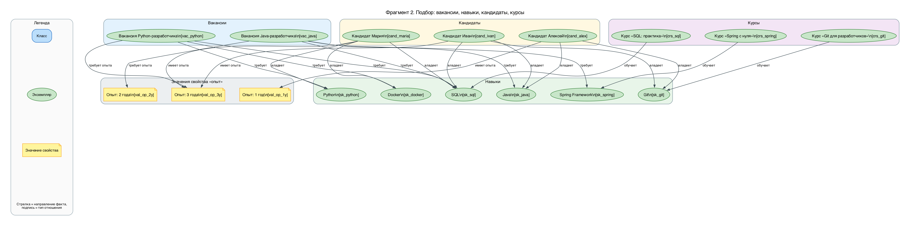

# ОТЧЁТ по лабораторной работе 02
## «Семантическая сеть»

**Дисциплина:** Интеллектуальные информационные системы и технологии
**Репозиторий:** https://github.com/Alex2aA/semantic-network-lab02

**Итоги по количественным требованиям**

| Требование | Норма | Факт |
|---|---|---|
| Содержательные узлы | 25–40 | **31** (11 классов, 17 экземпляров, 3 значения) |
| Факты-триплеты | ≥ 30 | **47** |
| Типы отношений | ≥ 5 | **8** (подкласс, экземпляр, часть, требует, владеет, обучает, требует опыта, имеет опыта) |
| Уровни иерархии | ≥ 2 | **3** (Вакансия → Вакансия разработчика → Вакансия бэкенд-разработчика) |
| Конкретные экземпляры | ≥ 3 | **17** |
| Компетентностные вопросы | 5 | **5** — все с воспроизводимыми ответами |
| Виды поиска | 3 | соседи по типу связи, предки/потомки, путь между узлами |
| Проверочные сценарии | 5 | **5** (включая отрицательный) — фактически 21 unittest-тест |
| Обзорная схема + фрагменты | 1 + 1–2 | **1 + 2** (с легендой на каждой) |

---

## 1. Домен, границы модели, пользователь

**Назначение сети.** Модель отвечает на вопросы специалиста по подбору (и самому
кандидату): каких навыков требует вакансия, каких навыков не хватает кандидату,
какие курсы закрывают выявленный разрыв, как понятия связаны между собой и
какой путь их соединяет.

**Пользователь.** HR-специалист / тимлид, отвечающий за найм бэкенд-разработчиков,
и кандидат, планирующий обучение.

**Что моделируется (внутри границ):**

* вакансии бэкенд-разработчиков — классы `Вакансия`, `Вакансия разработчика`,
  `Вакансия бэкенд-разработчика` и 2 конкретные вакансии;
* навыки — класс `Навык` с 4 подклассами и 7 конкретных навыков;
* кандидаты (3 человека), их навыки и опыт работы;
* курсы (3) и модули курсов (2), обучающие определённым навыкам;
* значения свойства «опыт работы» (1 год, 2 года, 3 года).

**Что сознательно вне границ:** зарплаты и грейды, география и формат работы,
процесс собеседований и воронка найма, рейтинги и отзывы на курсы, содержание
курсов помимо двух модулей, автоматическое отнесение кандидата к профессии
(правила классификации — отдельное расширение, а не знания графа).

**Модельные допущения.** Вакансии, кандидаты, курсы и факты обучения — вымышленный
учебный пример; в данных они помечены источником `model` («модельное допущение»),
а не выдаются за внешние факты. Внешние факты (Java — язык, Spring — фреймворк,
SQL — язык запросов и т. п.) ссылаются на официальные документации.

---

## 2. Пять компетентностных вопросов и ожидаемые ответы

Ожидаемые ответы записаны **до запуска** (константа `EXPECTED` в
`semantic_net/queries.py`) и сверяются с фактическим результатом в тестах
(`TestCompetencyQuestions`) и в команде `python -m semantic_net queries`.

| № | Вопрос | Ожидаемый ответ | Факт |
|---|---|---|---|
| Q1 | Какие навыки требуются для вакансии Java-разработчика? | [Java, Spring Framework, SQL] | совпадает |
| Q2 | Каких навыков не хватает кандидату Ивану для этой вакансии, что уже покрыто? | покрыты: [Java, SQL]; не хватает: [Spring Framework] | совпадает |
| Q3 | Какие курсы закроют недостающие навыки кандидата Алексея для той же вакансии? | курсы: [Курс «Spring с нуля», Курс «SQL: практика»] | совпадает |
| Q4 | Какие подклассы у класса «Вакансия» и какие конкретные вакансии к ним относятся? | подклассы: [Вакансия разработчика, Вакансия бэкенд-разработчика]; экземпляры: [Вакансия Java-разработчика, Вакансия Python-разработчика] | совпадает |
| Q5 | Какой путь связывает курс «SQL: практика» с вакансией Java-разработчика? | Курс «SQL: практика» —обучает→ SQL ←требует— Вакансия Java-разработчика | совпадает |

**Методы получения ответов** (все — из одних и тех же данных `data/`):

* Q1 — `neighbors(vac_java, relation='требует', direction='out')`;
* Q2 — два списка соседей (`требует` и `владеет`) и разность множеств;
* Q3 — разность множеств → `neighbors(навык, 'обучает', direction='in')`;
* Q4 — `descendants('vacancy')`: транзитивный обход `подкласс` + `экземпляр`;
* Q5 — `find_path('crs_sql', 'vac_java')`: поиск в ширину по дугам в обе стороны.

**Опорные факты Q2 (объяснение результата):**

```
Вакансия Java-разработчика —требует→ Java
Вакансия Java-разработчика —требует→ Spring Framework
Вакансия Java-разработчика —требует→ SQL
Кандидат Иван —владеет→ Java
Кандидат Иван —владеет→ Git
Кандидат Иван —владеет→ SQL
```

Spring Framework — требование вакансии, но связи «владеет» от Ивана к этому навыку
в графе нет, поэтому он попадает в разность множеств. Вывод держится на явно
записанных связях: граф ничего не «додумывает».

---

## 3. Словарь понятий (`data/nodes.json`)

31 узел со стабильными идентификаторами, типом, подписью, определением и источником.
Синонимы объединены (например, «Spring» = «Spring Framework»), классы и экземпляры
разделены, значения свойств не превращены в классы.

### 3.1. Классы (11)

| id | Название | Определение | Источник |
|---|---|---|---|
| `vacancy` | Вакансия | Открытая позиция в компании: множество объектов, сходных по роли и требованиям | модельное допущение |
| `vacancy_dev` | Вакансия разработчика | Вакансия на позицию разработчика программного обеспечения | модельное допущение |
| `vacancy_backend` | Вакансия бэкенд-разработчика | Вакансия разработчика серверной части приложения | модельное допущение |
| `skill` | Навык | Умение, необходимое для вакансии или имеющееся у кандидата | модельное допущение |
| `skill_lang` | Язык программирования | Язык программирования или запросов, входящий в навыки разработчика | модельное допущение |
| `skill_fw` | Фреймворк | Программный фреймворк: набор библиотек и инструментов поверх языка | модельное допущение |
| `skill_db` | Базы данных и языки запросов | Технологии хранения данных: СУБД и языки запросов к ним | модельное допущение |
| `skill_tool` | Инструмент разработки | Инструмент разработки и эксплуатации кода: контроль версий, контейнеризация | модельное допущение |
| `candidate` | Кандидат | Человек, рассматривающийся на вакансию; имеет опыт и набор навыков | модельное допущение |
| `course` | Курс | Образовательная программа, разделённая на модули и обучающая навыкам | модельное допущение |
| `course_module` | Модуль курса | Логическая часть курса, посвящённая одной теме | модельное допущение |

### 3.2. Экземпляры (17)

| id | Название | Экземпляр класса | Определение | Источник |
|---|---|---|---|---|
| `vac_java` | Вакансия Java-разработчика | vacancy_backend | Открытая позиция бэкенд-разработчика на Java и Spring | модельное допущение |
| `vac_python` | Вакансия Python-разработчика | vacancy_backend | Открытая позиция бэкенд-разработчика на Python | модельное допущение |
| `sk_java` | Java | skill_lang | Статически типизированный язык программирования платформы JVM | Oracle Java Tutorials |
| `sk_python` | Python | skill_lang | Интерпретируемый язык программирования общего назначения | Python.org |
| `sk_spring` | Spring Framework | skill_fw | Фреймворк прикладной разработки на Java | Spring Docs |
| `sk_django` | Django | skill_fw | Высокоуровневый веб-фреймворк на Python | Django Docs |
| `sk_sql` | SQL | skill_db | Стандартный язык запросов к реляционным базам данных | PostgreSQL Docs |
| `sk_git` | Git | skill_tool | Распределённая система контроля версий | Pro Git (git-scm.com) |
| `sk_docker` | Docker | skill_tool | Платформа контейнеризации приложений | Docker Docs |
| `cand_ivan` | Кандидат Иван | candidate | Бэкенд-разработчик, владеет Java, SQL и Git | модельное допущение |
| `cand_maria` | Кандидат Мария | candidate | Бэкенд-разработчик на Python, владеет Python, SQL и Docker | модельное допущение |
| `cand_alex` | Кандидат Алексей | candidate | Начинающий разработчик, владеет Java и Git | модельное допущение |
| `crs_spring` | Курс «Spring с нуля» | course | Онлайн-курс по Spring: от базовой конфигурации до внедрения зависимостей | модельное допущение |
| `crs_sql` | Курс «SQL: практика» | course | Практический курс SQL: запросы, индексы, оптимизация | модельное допущение |
| `crs_git` | Курс «Git для разработчиков» | course | Курс по Git: ветвление, слияние, командная работа | модельное допущение |
| `mod_spring_basics` | Модуль «Внедрение зависимостей» | course_module | Модуль курса Spring: контейнер и внедрение зависимостей | модельное допущение |
| `mod_sql_practice` | Модуль «Запросы и индексы» | course_module | Модуль курса SQL: сложные запросы и индексы | модельное допущение |

### 3.3. Значения свойств (3)

| id | Название | Назначение |
|---|---|---|
| `val_op_1y` | Опыт: 1 год | литерал свойства «опыт работы» |
| `val_op_2y` | Опыт: 2 года | литерал свойства «опыт работы» |
| `val_op_3y` | Опыт: 3 года | литерал свойства «опыт работы» |

Значения не являются классами: к ним не ведёт отношение «экземпляр», они
присоединяются к вакансиям и кандидатам свойственными отношениями
«требует опыта» и «имеет опыта».

---

## 4. Каталог отношений (`data/relations.json`)

Каталог составлен **до** построения графа. Для каждого отношения — паспорт:
смысл, допустимые типы концов, направление, обратная подпись, транзитивность
с обоснованием, симметричность, рефлексивность.

| id | Подпись | Смысл | Диапазон (субъект) | Диапазон (объект) | Направление | Обратное чтение | Транзитивно (обоснование) |
|---|---|---|---|---|---|---|---|
| `subclass` | подкласс | A — более частный случай B (AKO/subclass-of) | класс | класс | класс → общий класс | «содержит подкласс» (не сохраняется) | да: свойства наследуются вниз по цепочке |
| `instance` | экземпляр | A принадлежит классу B (ISA/instance-of) | экземпляр | класс | объект → класс | «содержит экземпляр» (не сохраняется) | нет: распространение на подклассы делает алгоритм предков |
| `part_of` | часть | A — часть составного B (part-of) | экземпляр класса course_module | экземпляр класса course | часть → целое | «включает» (не сохраняется) | да: часть части — часть целого |
| `requires` | требует | Вакансия требует навык | экземпляр класса vacancy | экземпляр класса skill | вакансия → навык | «требуется для» (не сохраняется) | нет: знание языка ≠ знание фреймворка |
| `knows` | владеет | Кандидат владеет навыком | экземпляр класса candidate | экземпляр класса skill | кандидат → навык | «освоен кандидатом» (не сохраняется) | нет: владение частью ≠ владение целым |
| `teaches` | обучает | Курс обучает навыку | экземпляр класса course | экземпляр класса skill | курс → навык | «изучается на курсе» (не сохраняется) | нет: курс по языку не обязан обучать фреймворку |
| `requires_exp` | требует опыта | Вакансия задаёт опыт — значение свойства | экземпляр класса vacancy | значение | вакансия → значение | обратное не применяется | нет: значения не образуют иерархию |
| `has_exp` | имеет опыта | Кандидат имеет опыт — значение свойства | экземпляр класса candidate | значение | кандидат → значение | обратное не применяется | нет: опыт сравнивается явным правилом |

**Контроль формулировок:** ни одна дуга не подписана «связан с»; каждая подпись —
глагол (или стандартная метка иерархии) и читается как короткое утверждение,
например «Вакансия Java-разработчика — требует → Spring Framework».
Обратное чтение всегда имеет отдельную подпись, поэтому направление стрелки
не теряет смысл. Симметричных отношений нет ни одно; все иерархические
отношения помечены как рефлексивные — запрет самоссылки (`s = o`) проверяется
валидатором.

---

## 5. Факты-триплеты и структура хранения

### 5.1. Структура хранилища

```
data/
├── nodes.json      — словарь: [{id, kind: class|instance|value, label, definition, source}]
├── relations.json  — паспорта отношений: [{id, label, meaning, domain_kinds,
│                        domain_classes, range_kinds, range_classes, direction,
│                        inverse, transitive, transitivity_basis, symmetric, irreflexive}]
├── triples.json    — факты: [{s, p, o, source}]  ← минимальный формат записи
└── sources.json    — источники: [{id, title, locator, note}]
```

Каждый факт хранится отдельно и несёт ссылку на источник или пометку `model`
(модельное допущение) — прослеживаемость каждого утверждения.
Программа загружает узлы и связи только из этих файлов (`semantic_net/loader.py`),
код отделён от данных.

### 5.2. Все 47 триплетов

| № | Субъект | Отношение | Объект | Источник |
|---|---|---|---|---|
| 1 | Вакансия разработчика | подкласс | Вакансия | модельное допущение |
| 2 | Вакансия бэкенд-разработчика | подкласс | Вакансия разработчика | модельное допущение |
| 3 | Язык программирования | подкласс | Навык | модельное допущение |
| 4 | Фреймворк | подкласс | Навык | модельное допущение |
| 5 | Базы данных и языки запросов | подкласс | Навык | модельное допущение |
| 6 | Инструмент разработки | подкласс | Навык | модельное допущение |
| 7 | Вакансия Java-разработчика | экземпляр | Вакансия бэкенд-разработчика | модельное допущение |
| 8 | Вакансия Python-разработчика | экземпляр | Вакансия бэкенд-разработчика | модельное допущение |
| 9 | Java | экземпляр | Язык программирования | Oracle Java Tutorials |
| 10 | Python | экземпляр | Язык программирования | Python.org |
| 11 | Spring Framework | экземпляр | Фреймворк | Spring Docs |
| 12 | Django | экземпляр | Фреймворк | Django Docs |
| 13 | SQL | экземпляр | Базы данных и языки запросов | PostgreSQL Docs |
| 14 | Git | экземпляр | Инструмент разработки | Pro Git |
| 15 | Docker | экземпляр | Инструмент разработки | Docker Docs |
| 16 | Кандидат Иван | экземпляр | Кандидат | модельное допущение |
| 17 | Кандидат Мария | экземпляр | Кандидат | модельное допущение |
| 18 | Кандидат Алексей | экземпляр | Кандидат | модельное допущение |
| 19 | Курс «Spring с нуля» | экземпляр | Курс | модельное допущение |
| 20 | Курс «SQL: практика» | экземпляр | Курс | модельное допущение |
| 21 | Курс «Git для разработчиков» | экземпляр | Курс | модельное допущение |
| 22 | Модуль «Внедрение зависимостей» | экземпляр | Модуль курса | модельное допущение |
| 23 | Модуль «Запросы и индексы» | экземпляр | Модуль курса | модельное допущение |
| 24 | Модуль «Внедрение зависимостей» | часть | Курс «Spring с нуля» | модельное допущение |
| 25 | Модуль «Запросы и индексы» | часть | Курс «SQL: практика» | модельное допущение |
| 26 | Вакансия Java-разработчика | требует | Java | модельное допущение |
| 27 | Вакансия Java-разработчика | требует | Spring Framework | модельное допущение |
| 28 | Вакансия Java-разработчика | требует | SQL | модельное допущение |
| 29 | Вакансия Python-разработчика | требует | Python | модельное допущение |
| 30 | Вакансия Python-разработчика | требует | SQL | модельное допущение |
| 31 | Вакансия Python-разработчика | требует | Docker | модельное допущение |
| 32 | Кандидат Иван | владеет | Java | модельное допущение |
| 33 | Кандидат Иван | владеет | Git | модельное допущение |
| 34 | Кандидат Иван | владеет | SQL | модельное допущение |
| 35 | Кандидат Мария | владеет | Python | модельное допущение |
| 36 | Кандидат Мария | владеет | SQL | модельное допущение |
| 37 | Кандидат Мария | владеет | Docker | модельное допущение |
| 38 | Кандидат Алексей | владеет | Java | модельное допущение |
| 39 | Кандидат Алексей | владеет | Git | модельное допущение |
| 40 | Курс «Spring с нуля» | обучает | Spring Framework | модельное допущение |
| 41 | Курс «SQL: практика» | обучает | SQL | модельное допущение |
| 42 | Курс «Git для разработчиков» | обучает | Git | модельное допущение |
| 43 | Вакансия Java-разработчика | требует опыта | Опыт: 2 года | модельное допущение |
| 44 | Вакансия Python-разработчика | требует опыта | Опыт: 3 года | модельное допущение |
| 45 | Кандидат Иван | имеет опыта | Опыт: 3 года | модельное допущение |
| 46 | Кандидат Мария | имеет опыта | Опыт: 3 года | модельное допущение |
| 47 | Кандидат Алексей | имеет опыта | Опыт: 1 год | модельное допущение |

Факты, отвечающие на 5 вопросов (26–42), внесены первыми; иерархия и контекст —
следом; после каждой серии изменений запускалась проверка целостности.

---

## 6. Визуализация

Все схемы построены программой (`python -m semantic_net render …`) из тех же
файлов `data/`, что и поиск: Graphviz DOT → PNG, исходники DOT сохранены в
`img/dots/`.

**Легенда (есть на каждой схеме):**

* синий прямоугольник — **класс**; зелёный эллипс — **экземпляр**;
  жёлтая заметка — **значение свойства**;
* **сплошная дуга** — предметное отношение; **пунктир серого цвета** —
  иерархия (`подкласс`, `экземпляр`, `часть`);
* **подпись дуги** — тип отношения, **стрелка** — направление факта;
* под каждым названием в квадратных скобках — стабильный идентификатор узла.

### 6.1. Обзорная схема всей сети


Все 31 узел и 47 дуг, сгруппированные в блоки: «Классы: вакансии / навыки /
участники», «Вакансии (экземпляры)», «Навыки (экземпляры)», «Кандидаты»,
«Курсы и модули», «Значения свойства «опыт»».

### 6.2. Фрагмент 1 — иерархия классов и принадлежность экземпляров


Только иерархические дуги (`подкласс`, `экземпляр`, `часть`): видны оба уровня
наследования вакансий, четыре подкласса навыка и принадлежность всех
экземпляров своим классам.

### 6.3. Фрагмент 2 — подбор: вакансии, навыки, кандидаты, курсы



Увеличенный фрагмент предметных связей: `требует`, `владеет`, `обучает`,
`требует опыта`, `имеет опыта` — удобно читать вместе с вопросами Q1–Q3 и Q5.

---

## 7. Программная реализация

Разделены **данные** (`data/`), **алгоритмы** (`semantic_net/network.py`,
`queries.py`) и **визуализация** (`render.py`). Ядро — чистый Python без
обязательных внешних зависимостей; Graphviz нужен только для картинок,
`rdflib`/`pyshacl` — только для бонусного экспорта.

Соответствие минимальному интерфейсу из задания:

| Функция задания | Реализация | Назначение |
|---|---|---|
| `neighbors(node, relation)` | `SemanticNetwork.neighbors(node, relation, direction)` | соседи по типу связи: `out` (по стрелке), `in` (против), `both` |
| `ancestors(node)` / `descendants(node)` | `SemanticNetwork.ancestors/descendants` | предки (классы и надклассы) и потомки (подклассы + экземпляры) |
| `find_path(source, target)` | `SemanticNetwork.find_path(source, target, relations=None)` | путь в ширину по дугам в обе стороны + `path_to_text` — понятная цепочка |
| `validate(network)` | `SemanticNetwork.validate()` | дубли id, неизвестные узлы и отношения, недопустимые типы концов, циклы иерархии, самоссылки, неизвестные источники, «сироты» |
| `render_graph(network)` | `render.render_graph(...)` | DOT → PNG для обзора и фрагментов по текущим данным |

Консольный интерфейс (`python -m semantic_net …`):

```
validate                      проверка целостности + сводка
queries                       5 вопросов: ожидание / факт / опорные факты
neighbors NODE --rel R --dir D соседи по типу отношения
ancestors NODE / descendants   предки и потомки в иерархии
path A B [--rel …]             путь как понятная цепочка
render --fragment NAME         обзорная схема и фрагменты
export-rdf                     RDF/Turtle + SPARQL + SHACL
stats                          числовая сводка
```

---

## 8. Результаты трёх видов поиска

### 8.1. Соседи по выбранному типу отношения

```
$ python -m semantic_net neighbors vac_java --rel requires
Соседи узла «Вакансия Java-разработчика» по отношению «требует», по стрелке:
  - Java [sk_java]
  - Spring Framework [sk_spring]
  - SQL [sk_sql]

$ python -m semantic_net neighbors sk_sql --rel requires --direction in
Соседи узла «SQL» по отношению «требует», против стрелки:
  - Вакансия Java-разработчика [vac_java]
  - Вакансия Python-разработчика [vac_python]
```

### 8.2. Предки и потомки в иерархии

```
$ python -m semantic_net ancestors vac_java
Предки узла «Вакансия Java-разработчика»:
  - [class] Вакансия бэкенд-разработчика [vacancy_backend]
  - [class] Вакансия разработчика [vacancy_dev]
  - [class] Вакансия [vacancy]

$ python -m semantic_net descendants vacancy
Потомки узла «Вакансия»:
  - [class] Вакансия разработчика [vacancy_dev]
  - [class] Вакансия бэкенд-разработчика [vacancy_backend]
  - [instance] Вакансия Java-разработчика [vac_java]
  - [instance] Вакансия Python-разработчика [vac_python]
```

### 8.3. Путь между двумя узлами

```
$ python -m semantic_net path crs_sql vac_java
Цепочка: Курс «SQL: практика» —обучает→ SQL ←требует— Вакансия Java-разработчика
Шаги:
  1. Курс «SQL: практика» —[обучает]→ SQL
  2. SQL ←[требует]— Вакансия Java-разработчика (движение против стрелки)
```

---

## 9. Тестирование: пять сценариев

Единый прогон: `python -m unittest discover -s tests -v` → **21 тест, все OK**.
Ожидаемый результат записан в тесте до запуска; факт фиксируется таблицей ниже.

| № | Проверка | Ожидаемый результат | Факт |
|---|---|---|---|
| 1 | Поиск по отношению | Все соседи нужного типа: у `vac_java` по «требует» — ровно {Java, Spring Framework, SQL}; у `sk_sql` против стрелки — {обе вакансии}; связи других типов и типы концов не попадают в выдачу | **выполняется** (`Test1NeighborsByRelation`, 4 теста) |
| 2 | Иерархия | Предки `vac_java`: бэкенд-вакансия → вакансия разработчика → вакансия; потомки `vacancy`: 2 подкласса + 2 экземпляра; у `sk_spring`: Фреймворк → Навык | **выполняется** (`Test2Hierarchy`, 4 теста) |
| 3 | Путь A → B | Существующая объяснимая цепочка: «Курс «SQL: практика» —обучает→ SQL ←требует— Вакансия Java-разработчика»; каждый шаг соответствует реально записанному факту | **выполняется** (`Test3PathExists`, 3 теста) |
| 4 | Нет пути *(отрицательный)* | Пустой результат без ошибки: между «Навык» и «Вакансия» нет пути только по иерархическим связям; при всех отношениях путь существует; неизвестный узел даёт понятную ошибку, а не падение | **выполняется**: `find_path` → `[]`, исключений нет (`Test4NoPath`, 3 теста) |
| 5 | Некорректные данные | Понятные сообщения проверки: в испорченном наборе обнаруживаются дубль id, неизвестный узел, неизвестное отношение, неверные типы концов (2 вида), цикл в иерархии, самоссылка, неизвестный источник; в исходных данных — 0 ошибок | **выполняется** (`Test5Validate`, 3 теста) |

Дополнительные тесты фиксируют требования работы: диапазон узлов 25–40,
≥ 30 триплетов, ≥ 5 типов отношений, ≥ 3 экземпляров, отсутствие дублей
идентификаторов и полное совпадение ответов Q1–Q5 с ожидаемыми.

Пример сообщения валидатора на испорченных данных:

```
[ОШИБКА] CYCLE_IN_HIERARCHY: цикл в отношении «подкласс»: a_cls → b_cls → a_cls
[ОШИБКА] UNKNOWN_NODE: факт №5: субъект 'ghost' отсутствует в словаре
[ОШИБКА] ENDPOINT_TYPE_MISMATCH: факт №8: субъект 'a_cls' имеет тип «класс», а отношение «владеет» допускает только: экземпляр
```

---

## 10. Объяснение пути (Q5)

**Запрос:** какой путь связывает курс «SQL: практика» с вакансией
Java-разработчика?

**Результат:**
`Курс «SQL: практика» —обучает→ SQL ←требует— Вакансия Java-разработчика`

**Как читать цепочку.** Первый шаг — фактическое утверждение «Курс «SQL: практика»
обучает навыку SQL» (стрелка вдоль записи). Второй шаг пройден против стрелки:
факт записан как «Вакансия Java-разработчика — требует → SQL», поэтому в цепочке
он выглядит как `SQL ←требует— Вакансия Java-разработчика`. Направление каждой
стрелки соответствует данным из `triples.json`, и тест
`test_path_directions_match_triples` проверяет каждый шаг против набора фактов.

**Смысл.** Курс и вакансия соединяются через общий навык SQL: закончивший курс
закрывает одно из трёх требований вакансии. Пустой результат по фильтру
`--rel subclass instance` для той же пары классов показывает, что иерархические
связи сами по себе этих понятий не соединяют — сцепку дают предметные отношения.

---

## 11. Бонус: RDF/Turtle, SPARQL, SHACL

Команда `python -m semantic_net export-rdf` (результат в `export/graph.ttl`):

* классы → `rdfs:Class`, отношение «подкласс» → `rdfs:subClassOf`,
  «экземпляр» → `rdf:type`, предметные отношения → свойства с
  `rdfs:domain` / `rdfs:range` из паспортов;
* SPARQL-запрос по требованиям вакансии:

```sparql
PREFIX sem: <https://example.org/semnet/>
PREFIX rdfs: <http://www.w3.org/2000/01/rdf-schema#>
SELECT ?vacancy ?skill WHERE {
  ?vacancy sem:requires ?skill .
  ?vacancy rdfs:label "Вакансия Java-разработчика"@ru .
}
```

результат: `vac_java → sk_java`, `vac_java → sk_spring`, `vac_java → sk_sql`;

* SHACL-проверка (`pyshacl`): у каждого класса есть русская подпись и
  определение, каждый экземпляр имеет `rdf:type` — вывод:
  **«SHACL-проверка: соответствует»**.

---

## 12. Вывод

**Что сеть умеет.**

* Хранит 31 понятие и 47 фактов с разделением классов, экземпляров и значений
  свойств; каждая дуга типизирована, направлена и читается как утверждение.
* Отвечает на 5 компетентностных вопросов воспроизводимо: поиск соседей по типу
  отношения, предки/потомки в иерархии, путь как объяснимая цепочка с
  опорными фактами.
* Самопроверяема: `validate` находит дубли идентификаторов, неизвестные узлы и
  отношения, недопустимые типы концов, циклы в иерархии, самоссылки и факты
  без источника — понятными сообщениями; в исходных данных 0 ошибок.
* Воспроизводима: данные отделены от кода, схемы и ответы строятся из тех же
  файлов, тесты фиксируют ожидания до запуска.
* Совместима со стандартами: экспорт в RDF/Turtle, запросы SPARQL, проверка SHACL.

**Границы модели.**

* Граф фиксирует только явно записанные связи: он не выводит «похожесть»
  кандидатов, не классифицирует их автоматически и не учитывает уровни
  владения навыком (есть/нет вместо шкал).
* Значения свойств (опыт) сравниваются программным правилом разности множеств,
  а не выводятся графом; иерархия значений не моделировалась.
* Обратные отношения не хранятся дублирующими фактами — обратное чтение
  выполняется поиском против стрелки, чтобы избежать рассинхронизации.
* Связь «навык вакансии → кандидат» возможна только через явные факты
  «владеет»; субъекты-сироты (например, `sk_django`) честно отражают
  неполноту данных и подсвечиваются предупреждением `ORPHAN_NODE`.

**Как улучшить.**

1. Шкала владения навыком (значения 0–5) и пороговые правила отбора.
2. Правила вывода (например, «зная Java, кандидат подходит под требования
   junior-Java») с объяснением сработавшего правила.
3. Обратные отношения как выводимые, а не хранимые факты + SPARQL CONSTRUCT.
4. Расширение предметной области: грейды, формат работы, воронка найма —
   с новыми классами, но теми же паспортами отношений.
5. Интерактивная фильтрация: выделение найденного пути и подсветка
   соседей по выбранному типу отношения в браузере.

---

## 13. Самооценка по критериям

| Критерий | Что подтверждает | Баллы |
|---|---|---|
| Семантика модели | 3 типа узлов, 8 типов связей с паспортами, направление и читаемость каждой дуги, иерархия из 3 уровней | 25 / 25 |
| Данные и источники | 47 триплетов (норма ≥ 30), словарь на 31 узел, ссылки на источники у внешних фактов, допущения помечены `model` | 15 / 15 |
| Программная реализация | данные/алгоритмы/визуализация разделены, загрузка из файлов, 5 функций поиска + валидатор, CLI | 20 / 20 |
| Поиск и объяснение | 3 вида запросов, понятные цепочки, ответы Q1–Q5 с опорными фактами | 20 / 20 |
| Тестирование | 5 сценариев включая отрицательный, ожидание записано до запуска, 21 тест OK | 10 / 10 |
| Визуализация и отчёт | обзорная схема + 2 фрагмента с легендой, воспроизводимое описание | 10 / 10 |
| **Итого** | | **100 / 100** |
| Бонус | экспорт RDF/Turtle + SPARQL + SHACL | **+4** |

---

## 14. Источники

1. ТГПУ — «Основы искусственного интеллекта: сетевые модели представления
   знаний», раздел 4.5 — понятие семантической сети, разметка связей, запросы.
2. Л. Ю. Грудцына — «Основы интеллектуальных систем для гуманитариев»,
   КФУ, 2017, с. 14–18 — пошаговый пример построения семантической сети.
3. Л. А. Артюшина — «Методы представления информации в простых семантических
   сетях», Научно-технический вестник ИТМО, 2020, т. 20, № 3, с. 382–393 —
   отношения IS-A и PART-OF.
4. A. Hogan et al. — Knowledge Graphs, ACM Computing Surveys, 2021 (arXiv,
   открытый текст) — модели графов, запросы, качество данных.
5. pzycloni / semantic_network (GitHub) — учебный пример на Python;
   сопоставление запросов с типами связей.
6. Документации технологий (для типов навыков): Oracle Java Tutorials,
   Python.org, Spring Framework Docs, Django Docs, PostgreSQL Docs (The SQL
   Language), Pro Git (git-scm.com), Docker Docs.

Полный список с пометками хранится в `data/sources.json`; каждый факт в
`data/triples.json` ссылается на один из этих идентификаторов или на `model`.

---

## 15. Воспроизводимость

```bash
git clone https://github.com/Alex2aA/semantic-network-lab02.git
cd semantic-network-lab02

brew install graphviz                # системная зависимость для графов
python3 -m venv .venv && source .venv/bin/activate
pip install -r requirements.txt

python -m unittest discover -s tests -v   # 21 тест, 5 сценариев
python -m semantic_net validate           # 0 ошибок
python -m semantic_net queries            # Q1–Q5: ожидание = факт
python -m semantic_net render --fragment overview
python -m semantic_net render --fragment hierarchy
python -m semantic_net render --fragment hiring
python -m semantic_net export-rdf         # RDF + SPARQL + SHACL
```

**Репозиторий с исходным кодом, данными и схемами:**
https://github.com/Alex2aA/semantic-network-lab02
