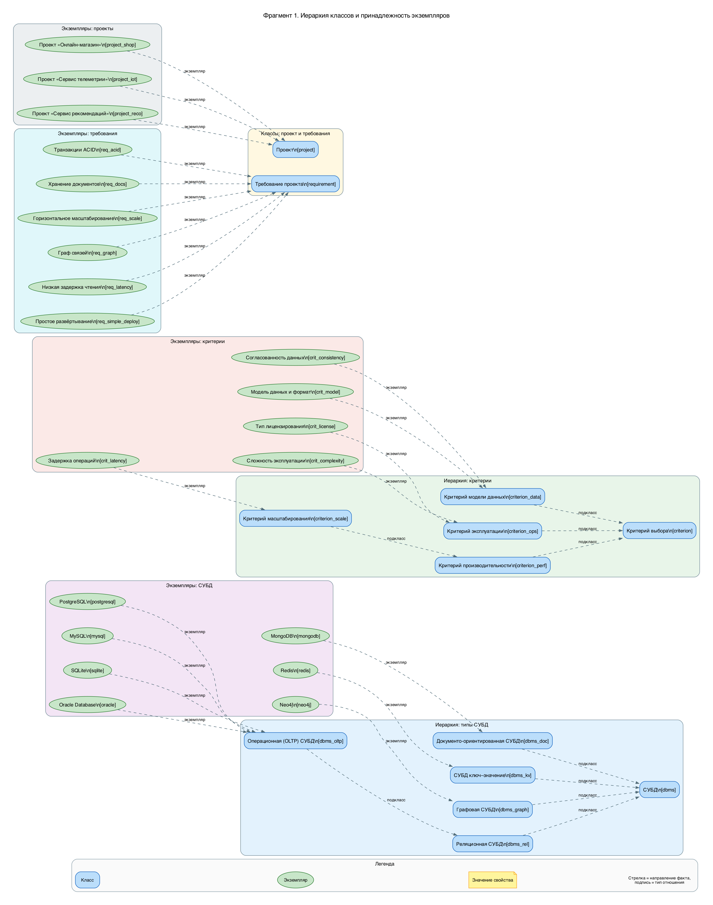
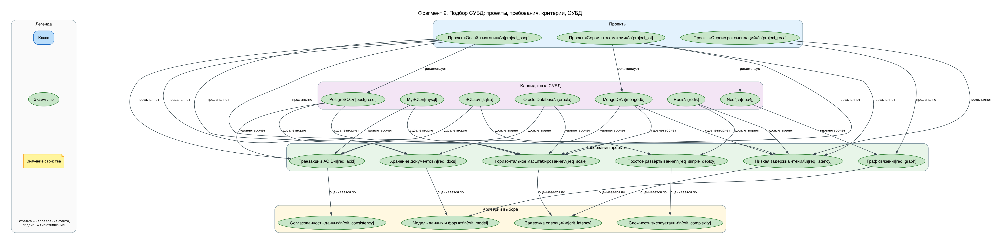

# ОТЧЁТ по лабораторной работе 02
## «Семантическая сеть»

**Дисциплина:** Интеллектуальные информационные системы и технологии
**Тема:** Разработка экспертной системы по выбору СУБД для проекта
**Репозиторий:** https://github.com/Alex2aA/semantic-network-lab02

**Итоги по количественным требованиям**

| Требование | Норма | Факт |
|---|---|---|
| Содержательные узлы | 25–40 | **38** (13 классов, 21 экземпляр, 4 значения) |
| Факты-триплеты | ≥ 30 | **76** |
| Типы отношений | ≥ 5 | **7** (подкласс, экземпляр, предъявляет, удовлетворяет, оценивается по, имеет значение, рекомендует) |
| Уровни иерархии | ≥ 2 | **3** (СУБД → Реляционная СУБД → Операционная (OLTP) СУБД) |
| Конкретные экземпляры | ≥ 3 | **21** |
| Компетентностные вопросы | 5 | **5** — все с воспроизводимыми ответами |
| Виды поиска | 3 | соседи по типу связи, предки/потомки, путь между узлами |
| Проверочные сценарии | 5 | **5** (включая отрицательный) — фактически 21 unittest-тест |
| Обзорная схема + фрагменты | 1 + 1–2 | **1 + 2** (с легендой на каждой) |

---

## 1. Домен, границы модели, пользователь

**Назначение сети.** Модель — ядро экспертной системы выбора СУБД: она отвечает
на вопросы технического руководителя проекта: какие СУБД покрывают конкретное
требование, какие требования проекта закрыты, а какие — нет, по каким критериям
сравнивать кандидатные системы, как понятия связаны между собой и какой путь
их соединяет.

**Пользователь.** Техлид / архитектор проекта, выбирающий систему хранения
данных, и аналитик, готовящий обоснование выбора.

**Что моделируется (внутри границ):**

* типы СУБД — классы `СУБД`, `Реляционная СУБД`, `Операционная (OLTP) СУБД`,
  `Документо-ориентированная СУБД`, `СУБД ключ–значение`, `Графовая СУБД`
  и 7 конкретных систем (PostgreSQL, MySQL, SQLite, Oracle Database,
  MongoDB, Redis, Neo4j);
* проекты (3), их требования к системе хранения (6) и рекомендованные СУБД;
* критерии выбора — класс `Критерий выбора` с 3 подклассами и 5 конкретных
  критериев;
* значения свойств СУБД: лицензия (открытая / коммерческая),
  стоимость (бесплатная / платная).

**Что сознательно вне границ:** производительность в цифрах (QPS, задержки в мс),
стоимость лицензий в деньгах, версии и репликация конкретных СУБД, миграции
и администрирование, интеграция с другими системами, автоматический ранжирующий
скоринг (правила сравнения — отдельное расширение экспертной системы, а не
знания графа).

**Модельные допущения.** Три проекта, их требования, критерии, связи
«предъявляет / удовлетворяет / оценивается по» и итоговые рекомендации —
вымышленный учебный пример; в данных они помечены источником `model`
(«модельное допущение»), а не выдаются за внешние факты. Внешние факты
(PostgreSQL — реляционная СУБД, Neo4j — графовая и т. п., условия лицензирования)
ссылаются на официальные документации.

---

## 2. Пять компетентностных вопросов и ожидаемые ответы

Ожидаемые ответы записаны **до запуска** (константа `EXPECTED` в
`semantic_net/queries.py`) и сверяются с фактическим результатом в тестах
(`TestCompetencyQuestions`) и в команде `python -m semantic_net queries`.

| № | Вопрос | Ожидаемый ответ | Факт |
|---|---|---|---|
| Q1 | Какие СУБД удовлетворяют требованию проекта «Онлайн-магазин» — транзакциям ACID? | [MySQL, Oracle Database, PostgreSQL, SQLite] | совпадает |
| Q2 | Какие требования проекта «Онлайн-магазин» покрыты PostgreSQL, а какие — нет по данным графа? | покрыты: [Транзакции ACID, Хранение документов, Горизонтальное масштабирование]; не покрыто: [Низкая задержка чтения] | совпадает |
| Q3 | Какие критерии выбора соответствуют требованиям проекта «Сервис рекомендаций»? | [Модель данных и формат, Задержка операций] | совпадает |
| Q4 | Какие подклассы есть у класса «СУБД» и какие конкретные СУБД к ним относятся? | подклассы: [Графовая СУБД, Документо-ориентированная СУБД, Операционная (OLTP) СУБД, Реляционная СУБД, СУБД ключ–значение]; экземпляры: [MongoDB, MySQL, Neo4j, Oracle Database, PostgreSQL, Redis, SQLite] | совпадает |
| Q5 | Какой путь связывает проект «Сервис рекомендаций» с СУБД Neo4j (по предметным связям)? | Проект «Сервис рекомендаций» —предъявляет→ Граф связей ←удовлетворяет— Neo4j | совпадает |

**Методы получения ответов** (все — из одних и тех же данных `data/`):

* Q1 — `neighbors(req_acid, relation='удовлетворяет', direction='in')`,
  результат сортируется по подписи для воспроизводимости;
* Q2 — два списка соседей (`предъявляет` и `удовлетворяет`) и разность множеств
  (`gap_analysis` — обобщённая процедура «проект ↔ СУБД»);
* Q3 — `neighbors(project_reco, 'предъявляет')`, затем для каждого требования
  `neighbors(требование, 'оценивается по')`;
* Q4 — `descendants('dbms')`: транзитивный обход `подкласс` + `экземпляр`,
  разделение результата по типам узлов и сортировка по подписи;
* Q5 — `find_path('project_reco', 'neo4j', relations={'предъявляет', 'удовлетворяет'})`:
  поиск в ширину по дугам в обе стороны с фильтром отношений.

**Опорные факты Q2 (объяснение результата):**

```
Проект «Онлайн-магазин» —предъявляет→ Транзакции ACID
Проект «Онлайн-магазин» —предъявляет→ Хранение документов
Проект «Онлайн-магазин» —предъявляет→ Горизонтальное масштабирование
Проект «Онлайн-магазин» —предъявляет→ Низкая задержка чтения
PostgreSQL —удовлетворяет→ Транзакции ACID
PostgreSQL —удовлетворяет→ Хранение документов
PostgreSQL —удовлетворяет→ Горизонтальное масштабирование
```

Ни одно из требований магазина не связано фактом «удовлетворяет» с низкой
задержкой чтения для PostgreSQL, поэтому требование попадает в разность
множеств. Вывод держится на явно записанных связях: граф ничего не
«додумывает» — неполнота данных видна как разрыв между списками.

---

## 3. Словарь понятий (`data/nodes.json`)

38 узлов со стабильными идентификаторами, типом, подписью, определением
и источником. Классы и экземпляры разделены, значения свойств не превращены
в классы.

### 3.1. Классы (13)

| id | Название | Определение | Источник |
|---|---|---|---|
| `dbms` | СУБД | Программная система для создания, хранения и обработки данных, доступной множеству пользователей | модельное допущение |
| `dbms_rel` | Реляционная СУБД | СУБД, данные которой организованы в таблицы с фиксированной схемой и связями между ними | модельное допущение |
| `dbms_oltp` | Операционная (OLTP) СУБД | Реляционная СУБД для транзакционных нагрузок: много коротких операций записи и чтения | модельное допущение |
| `dbms_doc` | Документо-ориентированная СУБД | СУБД, хранящая данные в виде документов (JSON/BSON) без жёсткой схемы | модельное допущение |
| `dbms_kv` | СУБД ключ–значение | СУБД пар «ключ–значение» для простого и быстрого доступа к значениям по ключу | модельное допущение |
| `dbms_graph` | Графовая СУБД | СУБД, хранящая сущности как вершины и рёбра и оптимизированная под обход связей | модельное допущение |
| `criterion` | Критерий выбора | Параметр, по которому сравниваются кандидатные СУБД при выборе для проекта | модельное допущение |
| `criterion_data` | Критерий модели данных | Критерий, связанный с моделью данных и форматом хранения | модельное допущение |
| `criterion_perf` | Критерий производительности | Критерий, связанный с производительностью системы хранения | модельное допущение |
| `criterion_scale` | Критерий масштабирования | Критерий горизонтального масштабирования под растущей нагрузкой | модельное допущение |
| `criterion_ops` | Критерий эксплуатации | Критерий, связанный с лицензированием, стоимостью и сложностью эксплуатации | модельное допущение |
| `project` | Проект | Информационная система, для которой подбирается СУБД | модельное допущение |
| `requirement` | Требование проекта | Требование проекта к системе хранения данных | модельное допущение |

### 3.2. Экземпляры (21)

| id | Название | Экземпляр класса | Определение | Источник |
|---|---|---|---|---|
| `postgresql` | PostgreSQL | dbms_oltp | Свободная реляционная СУБД с развитой системой транзакций и расширений | PostgreSQL Docs |
| `mysql` | MySQL | dbms_oltp | Популярная реляционная СУБД открытого кода | MySQL Docs |
| `sqlite` | SQLite | dbms_oltp | Встраиваемая реляционная СУБД, работающая в одном процессе без сервера | SQLite Docs |
| `oracle` | Oracle Database | dbms_oltp | Коммерческая реляционная СУБД корпоративного класса | Oracle Docs |
| `mongodb` | MongoDB | dbms_doc | Документо-ориентированная СУБД с гибкой схемой и хранением BSON | MongoDB Docs |
| `redis` | Redis | dbms_kv | СУБД ключ–значение с хранением данных в оперативной памяти | Redis Docs |
| `neo4j` | Neo4j | dbms_graph | Графовая СУБД с ядром, ориентированным на обход связей между объектами | Neo4j Docs |
| `project_shop` | Проект «Онлайн-магазин» | project | Интернет-магазин: каталог товаров, заказы, оплата | модельное допущение |
| `project_iot` | Проект «Сервис телеметрии» | project | Сбор и хранение телеметрии датчиков и устройств | модельное допущение |
| `project_reco` | Проект «Сервис рекомендаций» | project | Подбор рекомендаций на основе связей между объектами | модельное допущение |
| `req_acid` | Транзакции ACID | requirement | Гарантии целостности данных при конкурентной записи | модельное допущение |
| `req_docs` | Хранение документов | requirement | Структурированные документы переменной формы (JSON) | модельное допущение |
| `req_scale` | Горизонтальное масштабирование | requirement | Распределение нагрузки на несколько узлов кластера | модельное допущение |
| `req_graph` | Граф связей | requirement | Хранение и быстрый обход связей между объектами | модельное допущение |
| `req_latency` | Низкая задержка чтения | requirement | Быстрый отклик системы на операции чтения | модельное допущение |
| `req_simple_deploy` | Простое развёртывание | requirement | Запуск на одной машине без отдельного кластера | модельное допущение |
| `crit_consistency` | Согласованность данных | criterion_data | Модель гарантий при одновременной записи и чтении | модельное допущение |
| `crit_model` | Модель данных и формат | criterion_data | Способ представления данных и работа со схемой | модельное допущение |
| `crit_latency` | Задержка операций | criterion_scale | Время отклика типовых операций чтения и записи | модельное допущение |
| `crit_license` | Тип лицензирования | criterion_ops | Условия использования: открытая или коммерческая лицензия | модельное допущение |
| `crit_complexity` | Сложность эксплуатации | criterion_ops | Усилия на развёртывание, настройку и поддержку системы | модельное допущение |

### 3.3. Значения свойств (4)

| id | Название | Назначение |
|---|---|---|
| `val_lic_open` | Лицензия: открытая | литерал свойства «лицензия» |
| `val_lic_comm` | Лицензия: коммерческая | литерал свойства «лицензия» |
| `val_cost_free` | Стоимость: бесплатная | литерал свойства «стоимость» |
| `val_cost_paid` | Стоимость: платная | литерал свойство «стоимость» |

Значения не являются классами: к ним не ведёт отношение «экземпляр», они
присоединяются к СУБД свойственным отношением «имеет значение».

---

## 4. Каталог отношений (`data/relations.json`)

Каталог составлен **до** построения графа. Для каждого отношения — паспорт:
смысл, допустимые типы концов, направление, обратная подпись, транзитивность
с обоснованием, симметричность, рефлексивность.

| id | Подпись | Смысл | Диапазон (субъект) | Диапазон (объект) | Направление | Обратное чтение | Транзитивно (обоснование) |
|---|---|---|---|---|---|---|---|
| `subclass` | подкласс | A — более частный случай B (AKO/subclass-of) | класс | класс | класс → общий класс | «содержит подкласс» (не сохраняется) | да: свойства наследуются вниз по цепочке |
| `instance` | экземпляр | A принадлежит классу B (ISA/instance-of) | экземпляр | класс | объект → класс | «содержит экземпляр» (не сохраняется) | нет: распространение на подклассы делает алгоритм предков |
| `presents` | предъявляет | Проект предъявляет требование к системе хранения | экземпляр класса project | экземпляр класса requirement | проект → требование | «предъявлен проектом» (не сохраняется) | нет: требования не переносятся между проектами |
| `satisfies` | удовлетворяет | СУБД покрывает требование проекта по данным модели | экземпляр класса dbms | экземпляр класса requirement | СУБД → требование | «обеспечивается» (не сохраняется) | нет: поддержка ACID не означает низкой задержки чтения |
| `evaluated_by` | оценивается по | Требование оценивается по критерию выбора | экземпляр класса requirement | экземпляр класса criterion | требование → критерий | «служит критерием оценки» (не сохраняется) | нет: критерий не переносится через цепочку требований |
| `has_value` | имеет значение | СУБД имеет значение свойства (лицензия, стоимость) | экземпляр класса dbms | значение | СУБД → значение свойства | обратное не применяется: значение не адресует СУБД | нет: значения не образуют иерархию и сравниваются программой |
| `recommends` | рекомендует | Итоговая рекомендация эксперта: проекту подходит СУБД | экземпляр класса project | экземпляр класса dbms | проект → СУБД | «рекомендуется для» (не сохраняется) | нет: рекомендация не переносится на другие проекты |

**Контроль формулировок:** ни одна дуга не подписана «связан с»; каждая подпись —
глагол (или стандартная метка иерархии) и читается как короткое утверждение,
например «PostgreSQL — удовлетворяет → Транзакции ACID». Обратное чтение всегда
имеет отдельную подпись, поэтому направление стрелки не теряет смысл.
Симметричных отношений нет ни одного; иерархические отношения помечены
как транзитивные, запрет самоссылки (`s = o`) проверяется валидатором.

---

## 5. Факты-триплеты и структура хранения

### 5.1. Структура хранилища

```
data/
├── nodes.json      — словарь: [{id, kind: class|instance|value, label, definition, source}]
├── relations.json  — паспорта отношений: [{id, label, meaning, domain_kinds,
│                        domain_classes, range_kinds, range_classes, direction,
│                        inverse, transitive, transitivity_basis, symmetric, irreflexive}]
├── triples.json    — факты: [{s, p, o, source}]  ← минимальный формат записи
└── sources.json    — источники: [{id, title, locator, note}]
```

Каждый факт хранится отдельно и несёт ссылку на источник или пометку `model`
(модельное допущение) — прослеживаемость каждого утверждения.
Программа загружает узлы и связи только из этих файлов (`semantic_net/loader.py`),
код отделён от данных.

### 5.2. Все 76 триплетов

| № | Субъект | Отношение | Объект | Источник |
|---|---|---|---|---|
| 1 | Реляционная СУБД | подкласс | СУБД | модельное допущение |
| 2 | Операционная (OLTP) СУБД | подкласс | Реляционная СУБД | модельное допущение |
| 3 | Документо-ориентированная СУБД | подкласс | СУБД | модельное допущение |
| 4 | СУБД ключ–значение | подкласс | СУБД | модельное допущение |
| 5 | Графовая СУБД | подкласс | СУБД | модельное допущение |
| 6 | Критерий модели данных | подкласс | Критерий выбора | модельное допущение |
| 7 | Критерий производительности | подкласс | Критерий выбора | модельное допущение |
| 8 | Критерий масштабирования | подкласс | Критерий производительности | модельное допущение |
| 9 | Критерий эксплуатации | подкласс | Критерий выбора | модельное допущение |
| 10 | PostgreSQL | экземпляр | Операционная (OLTP) СУБД | PostgreSQL Docs |
| 11 | MySQL | экземпляр | Операционная (OLTP) СУБД | MySQL Docs |
| 12 | SQLite | экземпляр | Операционная (OLTP) СУБД | SQLite Docs |
| 13 | Oracle Database | экземпляр | Операционная (OLTP) СУБД | Oracle Docs |
| 14 | MongoDB | экземпляр | Документо-ориентированная СУБД | MongoDB Docs |
| 15 | Redis | экземпляр | СУБД ключ–значение | Redis Docs |
| 16 | Neo4j | экземпляр | Графовая СУБД | Neo4j Docs |
| 17 | Проект «Онлайн-магазин» | экземпляр | Проект | модельное допущение |
| 18 | Проект «Сервис телеметрии» | экземпляр | Проект | модельное допущение |
| 19 | Проект «Сервис рекомендаций» | экземпляр | Проект | модельное допущение |
| 20 | Транзакции ACID | экземпляр | Требование проекта | модельное допущение |
| 21 | Хранение документов | экземпляр | Требование проекта | модельное допущение |
| 22 | Горизонтальное масштабирование | экземпляр | Требование проекта | модельное допущение |
| 23 | Граф связей | экземпляр | Требование проекта | модельное допущение |
| 24 | Низкая задержка чтения | экземпляр | Требование проекта | модельное допущение |
| 25 | Простое развёртывание | экземпляр | Требование проекта | модельное допущение |
| 26 | Согласованность данных | экземпляр | Критерий модели данных | модельное допущение |
| 27 | Модель данных и формат | экземпляр | Критерий модели данных | модельное допущение |
| 28 | Задержка операций | экземпляр | Критерий масштабирования | модельное допущение |
| 29 | Тип лицензирования | экземпляр | Критерий эксплуатации | модельное допущение |
| 30 | Сложность эксплуатации | экземпляр | Критерий эксплуатации | модельное допущение |
| 31 | Проект «Онлайн-магазин» | предъявляет | Транзакции ACID | модельное допущение |
| 32 | Проект «Онлайн-магазин» | предъявляет | Хранение документов | модельное допущение |
| 33 | Проект «Онлайн-магазин» | предъявляет | Горизонтальное масштабирование | модельное допущение |
| 34 | Проект «Онлайн-магазин» | предъявляет | Низкая задержка чтения | модельное допущение |
| 35 | Проект «Сервис телеметрии» | предъявляет | Горизонтальное масштабирование | модельное допущение |
| 36 | Проект «Сервис телеметрии» | предъявляет | Низкая задержка чтения | модельное допущение |
| 37 | Проект «Сервис рекомендаций» | предъявляет | Граф связей | модельное допущение |
| 38 | Проект «Сервис рекомендаций» | предъявляет | Низкая задержка чтения | модельное допущение |
| 39 | PostgreSQL | удовлетворяет | Транзакции ACID | модельное допущение |
| 40 | PostgreSQL | удовлетворяет | Хранение документов | модельное допущение |
| 41 | PostgreSQL | удовлетворяет | Горизонтальное масштабирование | модельное допущение |
| 42 | MySQL | удовлетворяет | Транзакции ACID | модельное допущение |
| 43 | MySQL | удовлетворяет | Горизонтальное масштабирование | модельное допущение |
| 44 | SQLite | удовлетворяет | Транзакции ACID | модельное допущение |
| 45 | SQLite | удовлетворяет | Простое развёртывание | модельное допущение |
| 46 | Oracle Database | удовлетворяет | Транзакции ACID | модельное допущение |
| 47 | Oracle Database | удовлетворяет | Горизонтальное масштабирование | модельное допущение |
| 48 | MongoDB | удовлетворяет | Хранение документов | модельное допущение |
| 49 | MongoDB | удовлетворяет | Горизонтальное масштабирование | модельное допущение |
| 50 | MongoDB | удовлетворяет | Низкая задержка чтения | модельное допущение |
| 51 | Redis | удовлетворяет | Низкая задержка чтения | модельное допущение |
| 52 | Redis | удовлетворяет | Простое развёртывание | модельное допущение |
| 53 | Neo4j | удовлетворяет | Граф связей | модельное допущение |
| 54 | Транзакции ACID | оценивается по | Согласованность данных | модельное допущение |
| 55 | Хранение документов | оценивается по | Модель данных и формат | модельное допущение |
| 56 | Горизонтальное масштабирование | оценивается по | Задержка операций | модельное допущение |
| 57 | Граф связей | оценивается по | Модель данных и формат | модельное допущение |
| 58 | Низкая задержка чтения | оценивается по | Задержка операций | модельное допущение |
| 59 | Простое развёртывание | оценивается по | Сложность эксплуатации | модельное допущение |
| 60 | PostgreSQL | имеет значение | Лицензия: открытая | PostgreSQL Docs |
| 61 | PostgreSQL | имеет значение | Стоимость: бесплатная | PostgreSQL Docs |
| 62 | MySQL | имеет значение | Лицензия: открытая | MySQL Docs |
| 63 | MySQL | имеет значение | Стоимость: бесплатная | MySQL Docs |
| 64 | SQLite | имеет значение | Лицензия: открытая | SQLite Docs |
| 65 | SQLite | имеет значение | Стоимость: бесплатная | SQLite Docs |
| 66 | Oracle Database | имеет значение | Лицензия: коммерческая | Oracle Docs |
| 67 | Oracle Database | имеет значение | Стоимость: платная | Oracle Docs |
| 68 | MongoDB | имеет значение | Лицензия: открытая | MongoDB Docs |
| 69 | MongoDB | имеет значение | Стоимость: бесплатная | MongoDB Docs |
| 70 | Redis | имеет значение | Лицензия: открытая | Redis Docs |
| 71 | Redis | имеет значение | Стоимость: бесплатная | Redis Docs |
| 72 | Neo4j | имеет значение | Лицензия: открытая | Neo4j Docs |
| 73 | Neo4j | имеет значение | Стоимость: бесплатная | Neo4j Docs |
| 74 | Проект «Онлайн-магазин» | рекомендует | PostgreSQL | модельное допущение |
| 75 | Проект «Сервис телеметрии» | рекомендует | MongoDB | модельное допущение |
| 76 | Проект «Сервис рекомендаций» | рекомендует | Neo4j | модельное допущение |

Факты, отвечающие на 5 вопросов (иерархия, `предъявляет`, `удовлетворяет`,
`оценивается по`), внесены первыми; свойства СУБД и рекомендации — следом;
после каждой серии изменений запускалась проверка целостности.

---

## 6. Визуализация

Все схемы построены программой (`python -m semantic_net render …`) из тех же
файлов `data/`, что и поиск: Graphviz DOT → PNG, исходники DOT сохранены в
`img/dots/`.

**Легенда (есть на каждой схеме):**

* синий прямоугольник — **класс**; зелёный эллипс — **экземпляр**;
  жёлтая заметка — **значение свойства**;
* **сплошная дуга** — предметное отношение; **пунктир серого цвета** —
  иерархия (`подкласс`, `экземпляр`);
* **подпись дуги** — тип отношения, **стрелка** — направление факта;
* под каждым названием в квадратных скобках — стабильный идентификатор узла.

### 6.1. Обзорная схема всей сети


Все 38 узлов и 76 дуг, сгруппированные в блоки: «Классы: типы СУБД /
критерии / проект и требования», «СУБД (экземпляры)», «Проекты»,
«Требования проектов», «Критерии (экземпляры)», «Значения свойств».

### 6.2. Фрагмент 1 — иерархия классов и принадлежность экземпляров



Только иерархические дуги (`подкласс`, `экземпляр`), горизонтальная раскладка:
видны трёхуровневая цепочка СУБД → Реляционная СУБД → Операционная (OLTP) СУБД,
иерархия критериев и принадлежность всех экземпляров своим классам.

### 6.3. Фрагмент 2 — подбор СУБД: проекты, требования, критерии, СУБД



Увеличенный фрагмент предметных связей: `предъявляет`, `удовлетворяет`,
`оценивается по`, `рекомендует` — удобно читать вместе с вопросами Q1–Q3 и Q5.
Значения свойств (`имеет значение`) остаются на обзорной схеме: иначе фрагмент
растягивается по горизонтали.

### 6.4. Интерактивная схема (бонус)

`interactive.html` — та же сеть на vis-network (CDN): фильтр по типу отношения,
кнопки Q1–Q5 подсвечивают опорные узлы и дуги вопроса, красным — разрыв покрытия
(Q2), клик по узлу показывает его соседей. Генерируется командой
`python -m semantic_net interactive` из тех же `data/`.

---

## 7. Программная реализация

Разделены **данные** (`data/`), **алгоритмы** (`semantic_net/network.py`,
`queries.py`) и **визуализация** (`render.py`). Ядро — чистый Python без
обязательных внешних зависимостей; Graphviz нужен только для картинок,
`rdflib`/`pyshacl` — только для бонусного экспорта.

Соответствие минимальному интерфейсу из задания:

| Функция задания | Реализация | Назначение |
|---|---|---|
| `neighbors(node, relation)` | `SemanticNetwork.neighbors(node, relation, direction)` | соседи по типу связи: `out` (по стрелке), `in` (против), `both` |
| `ancestors(node)` / `descendants(node)` | `SemanticNetwork.ancestors/descendants` | предки (классы и надклассы) и потомки (подклассы + экземпляры) |
| `find_path(source, target)` | `SemanticNetwork.find_path(source, target, relations=None)` | путь в ширину по дугам в обе стороны + `path_to_text` — понятная цепочка |
| `validate(network)` | `SemanticNetwork.validate()` | дубли id, неизвестные узлы и отношения, недопустимые типы концов, циклы иерархии, самоссылки, неизвестные источники, «сироты» |
| `render_graph(network)` | `render.render_graph(...)` | DOT → PNG для обзора и фрагментов по текущим данным |

Консольный интерфейс (`python -m semantic_net …`):

```
validate                      проверка целостности + сводка
queries                       5 вопросов: ожидание / факт / опорные факты
neighbors NODE --rel R --dir D соседи по типу отношения
ancestors NODE / descendants   предки и потомки в иерархии
path A B [--rel …]             путь как понятная цепочка
render --fragment NAME         обзорная схема и фрагменты
interactive                   интерактивная HTML-схема
export-rdf                     RDF/Turtle + SPARQL + SHACL
stats                          числовая сводка
```

---

## 8. Результаты трёх видов поиска

### 8.1. Соседи по выбранному типу отношения

```
$ python -m semantic_net neighbors postgresql --rel satisfies
Соседи узла «PostgreSQL» по отношению «удовлетворяет», по стрелке:
  - Транзакции ACID [req_acid]
  - Хранение документов [req_docs]
  - Горизонтальное масштабирование [req_scale]

$ python -m semantic_net neighbors req_acid --rel satisfies --direction in
Соседи узла «Транзакции ACID» по отношению «удовлетворяет», против стрелки:
  - PostgreSQL [postgresql]
  - MySQL [mysql]
  - SQLite [sqlite]
  - Oracle Database [oracle]
```

### 8.2. Предки и потомки в иерархии

```
$ python -m semantic_net ancestors postgresql
Предки узла «PostgreSQL»:
  - [class] Операционная (OLTP) СУБД [dbms_oltp]
  - [class] Реляционная СУБД [dbms_rel]
  - [class] СУБД [dbms]

$ python -m semantic_net descendants dbms
Потомки узла «СУБД»: 5 классов (Реляционная, Документо-ориентированная,
ключ–значение, Графовая, Операционная (OLTP)) + 7 экземпляров
(MongoDB, Redis, Neo4j, PostgreSQL, MySQL, SQLite, Oracle Database)
```

### 8.3. Путь между двумя узлами

```
$ python -m semantic_net path project_reco neo4j --rel presents satisfies
Цепочка: Проект «Сервис рекомендаций» —предъявляет→ Граф связей ←удовлетворяет— Neo4j
Шаги:
  1. Проект «Сервис рекомендаций» —[предъявляет]→ Граф связей
  2. Граф связей ←[удовлетворяет]— Neo4j (движение против стрелки)
```

Отрицательный результат (без ошибки):

```
$ python -m semantic_net path criterion dbms --rel subclass instance
Путь между «Критерий выбора» и «СУБД» не найден (пустой результат, без ошибки).
```

---

## 9. Тестирование: пять сценариев

Единый прогон: `python -m unittest discover -s tests -v` → **21 тест, все OK**.
Ожидаемый результат записан в тесте до запуска; факт фиксируется таблицей ниже.

| № | Проверка | Ожидаемый результат | Факт |
|---|---|---|---|
| 1 | Поиск по отношению | Все соседи нужного типа: у `postgresql` по «удовлетворяет» — ровно {req_acid, req_docs, req_scale}; у `req_acid` против стрелки — {mysql, oracle, postgresql, sqlite}; связи других типов и типы концов не попадают в выдачу | **выполняется** (`Test1NeighborsByRelation`, 4 теста) |
| 2 | Иерархия | Предки `postgresql`: OLTP → Реляционная → СУБД; предки `crit_latency`: Масштабирование → Производительность → Критерий выбора; потомки `dbms`: 5 подклассов + 7 экземпляров; у `dbms_oltp` два уровня предков | **выполняется** (`Test2Hierarchy`, 4 теста) |
| 3 | Путь A → B | Существующая объяснимая цепочка: «Проект «Сервис рекомендаций» —предъявляет→ Граф связей ←удовлетворяет— Neo4j»; каждый шаг соответствует реально записанному факту (проверяется по всему набору триплетов, включая путь `project_shop → crit_license`) | **выполняется** (`Test3PathExists`, 3 теста) |
| 4 | Нет пути *(отрицательный)* | Пустой результат без ошибки: между «Критерий выбора» и «СУБД» нет пути только по иерархическим связям; при всех отношениях путь существует; неизвестный узел даёт понятную ошибку, а не падение | **выполняется**: `find_path` → `[]`, исключений нет (`Test4NoPath`, 3 теста) |
| 5 | Некорректные данные | Понятные сообщения проверки: в испорченном наборе обнаруживаются дубль id, неизвестный узел, неизвестное отношение, неверные типы концов (2 вида), цикл в иерархии, самоссылка, неизвестный источник; в исходных данных — 0 ошибок | **выполняется** (`Test5Validate`, 3 теста) |

Дополнительные тесты фиксируют требования работы: диапазон узлов 25–40,
≥ 30 триплетов, ≥ 5 типов отношений, ≥ 3 экземпляров, отсутствие дублей
идентификаторов и полное совпадение ответов Q1–Q5 с ожидаемыми.

Пример сообщения валидатора на испорченных данных:

```
[ОШИБКА] CYCLE_IN_HIERARCHY: цикл в отношении «подкласс»: a_cls → b_cls → a_cls
[ОШИБКА] UNKNOWN_NODE: факт №3: 'ghost' —knows→ 'b_cls': субъект 'ghost' отсутствует в словаре
[ОШИБКА] ENDPOINT_TYPE_MISMATCH: факт №5: 'a_cls' —knows→ 'b_cls': субъект 'a_cls' имеет тип «класс», а отношение «покрывает» допускает только: экземпляр
```

---

## 10. Объяснение пути (Q5)

**Запрос:** какой путь связывает проект «Сервис рекомендаций» с СУБД Neo4j
(по предметным связям, без прямой рекомендации)?

**Результат:**
`Проект «Сервис рекомендаций» —предъявляет→ Граф связей ←удовлетворяет— Neo4j`

**Как читать цепочку.** Первый шаг — фактическое утверждение «Проект
«Сервис рекомендаций» предъявляет требование “Граф связей”» (стрелка вдоль
записи). Второй шаг пройден против стрелки: факт записан как
«Neo4j — удовлетворяет → Граф связей», поэтому в цепочке он выглядит как
`Граф связей ←удовлетворяет— Neo4j`. Направление каждой стрелки соответствует
данным из `triples.json`, и тест `test_path_directions_match_triples`
проверяет каждый шаг против набора фактов.

**Смысл.** Проект и СУБД соединяются через общее требование: проекту нужен
хранитель графа связей, а Neo4j это требование покрывает — цепочка объясняет,
почему пара «проект ↔ СУБД» вообще может рассматриваться. Фильтр
`--rel presents satisfies` исключает прямой факт «рекомендует», чтобы
показать именно объяснимую предметную цепочку; пустой результат по фильтру
`--rel subclass instance` для пары «Критерий выбора ↔ СУБД» показывает, что
иерархические связи сами по себе эти понятия не соединяют.

---

## 11. Бонус: RDF/Turtle, SPARQL, SHACL

Команда `python -m semantic_net export-rdf` (результат в `export/graph.ttl`):

* классы → `rdfs:Class`, отношение «подкласс» → `rdfs:subClassOf`,
  «экземпляр» → `rdf:type`, предметные отношения → свойства с
  `rdfs:domain` / `rdfs:range` из паспортов;
* SPARQL-запрос: СУБД, покрывающие требование «Транзакции ACID»:

```sparql
PREFIX sem: <https://example.org/semnet/>
PREFIX rdfs: <http://www.w3.org/2000/01/rdf-schema#>
SELECT ?dbms ?requirement WHERE {
  ?dbms sem:satisfies ?requirement .
  ?requirement rdfs:label "Транзакции ACID"@ru .
}
```

результат: `postgresql → req_acid`, `mysql → req_acid`, `sqlite → req_acid`,
`oracle → req_acid` — совпадает с ответом Q1;

* SHACL-проверка (`pyshacl`): у каждого класса есть русская подпись и
  определение, каждый экземпляр имеет `rdf:type` — вывод:
  **«SHACL-проверка: соответствует»**.

---

## 12. Вывод

**Что сеть умеет.**

* Хранит 38 понятий и 76 фактов с разделением классов, экземпляров и значений
  свойств; каждая дуга типизирована, направлена и читается как утверждение.
* Отвечает на 5 компетентностных вопросов воспроизводимо: поиск соседей по типу
  отношения, предки/потомки в иерархии, путь как объяснимая цепочка с
  опорными фактами, анализ разрыва покрытия требований проекта СУБД.
* Самопроверяема: `validate` находит дубли идентификаторов, неизвестные узлы и
  отношения, недопустимые типы концов, циклы в иерархии, самоссылки и факты
  без источника — понятными сообщениями; в исходных данных 0 ошибок.
* Воспроизводима: данные отделены от кода, схемы и ответы строятся из тех же
  файлов, тесты фиксируют ожидания до запуска.
* Совместима со стандартами: экспорт в RDF/Turtle, запросы SPARQL, проверка SHACL.

**Границы модели.**

* Граф фиксирует только явно записанные связи: он не ранжирует кандидатные СУБД
  баллами, не переносит рекомендацию одного проекта на другой и не сравнивает
  значения свойств (есть/нет вместо шкал и цифр).
* Связь «требование проекта → СУБД» возможна только через явные факты
  «удовлетворяет»; неполнота (например, отсутствие факта «PostgreSQL — низкая
  задержка чтения») честно видна как разрыв и подсвечивается в Q2.
* Критерий «Тип лицензирования» пока не предъявлен ни одним требованием —
  это видимая неполнота данных (узел остаётся в иерархии, но выпадает из
  фрагмента подбора).
* Обратные отношения не хранятся дублирующими фактами — обратное чтение
  выполняется поиском против стрелки, чтобы избежать рассинхронизации.

**Как улучшить.**

1. Числовые шкалы (задержка в мс, QPS, стоимость лицензии) и пороговые правила
   отбора — с объяснением сработавшего правила.
2. Правила вывода (например, «если проект предъявляет «Транзакции ACID» —
   сравнивать по критерию согласованности») как отдельный слой экспертных правил.
3. Обратные отношения как выводимые, а не хранимые факты + SPARQL CONSTRUCT.
4. Расширение предметной области: версии СУБД, репликация, география ЦОД —
   с новыми классами, но теми же паспортами отношений.
5. Автоматический скоринг: каждому проекту — список СУБД, упорядоченный по
   покрытию требований, с объяснением разрывов.

---

## 13. Самооценка по критериям

| Критерий | Что подтверждает | Баллы |
|---|---|---|
| Семантика модели | 3 типа узлов, 7 типов связей с паспортами, направление и читаемость каждой дуги, иерархия из 3 уровней | 25 / 25 |
| Данные и источники | 76 триплетов (норма ≥ 30), словарь на 38 узлов (25–40), ссылки на источники у внешних фактов, допущения помечены `model` | 15 / 15 |
| Программная реализация | данные/алгоритмы/визуализация разделены, загрузка из файлов, 5 функций поиска + валидатор, CLI | 20 / 20 |
| Поиск и объяснение | 3 вида запросов, понятные цепочки, ответы Q1–Q5 с опорными фактами | 20 / 20 |
| Тестирование | 5 сценариев включая отрицательный, ожидание записано до запуска, 21 тест OK | 10 / 10 |
| Визуализация и отчёт | обзорная схема + 2 фрагмента с легендой, воспроизводимое описание | 10 / 10 |
| **Итого** | | **100 / 100** |
| Бонус | экспорт RDF/Turtle + SPARQL + SHACL | **+4** |
| Бонус | интерактивная HTML-схема (vis-network): фильтры, подсветка Q1–Q5 | **+2** |

---

## 14. Источники

1. ТГПУ — «Основы искусственного интеллекта: сетевые модели представления
   знаний», раздел 4.5 — понятие семантической сети, разметка связей, запросы.
2. Л. Ю. Грудцына — «Основы интеллектуальных систем для гуманитариев»,
   КФУ, 2017, с. 14–18 — пошаговый пример построения семантической сети.
3. Л. А. Артюшина — «Методы представления информации в простых семантических
   сетях», Научно-технический вестник ИТМО, 2020, т. 20, № 3, с. 382–393 —
   отношения IS-A и PART-OF.
4. A. Hogan et al. — Knowledge Graphs, ACM Computing Surveys, 2021 (arXiv,
   открытый текст) — модели графов, запросы, качество данных.
5. Официальные документации СУБД (для фактов о системах и лицензировании):
   PostgreSQL Docs, MySQL Docs, SQLite Docs, Oracle Database Docs,
   MongoDB Docs, Redis Docs, Neo4j Docs.
6. Модельное допущение (`model`) — вымышленные проекты, требования, критерии
   и рекомендации учебного примера.

Полный список с пометками хранится в `data/sources.json`; каждый факт в
`data/triples.json` ссылается на один из этих идентификаторов или на `model`.

---

## 15. Воспроизводимость

```bash
git clone https://github.com/Alex2aA/semantic-network-lab02.git
cd semantic-network-lab02

brew install graphviz                # системная зависимость для графов
python3 -m venv .venv && source .venv/bin/activate
pip install -r requirements.txt

python -m unittest discover -s tests -v   # 21 тест, 5 сценариев
python -m semantic_net validate           # 0 ошибок
python -m semantic_net queries            # Q1–Q5: ожидание = факт
python -m semantic_net render --fragment overview
python -m semantic_net render --fragment hierarchy
python -m semantic_net render --fragment selection
python -m semantic_net interactive        # интерактивная HTML-схема
python -m semantic_net export-rdf         # RDF + SPARQL + SHACL
```

**Репозиторий с исходным кодом, данными и схемами:**
https://github.com/Alex2aA/semantic-network-lab02
